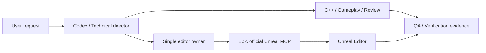

English · [한국어](docs/readme/README_ko.md)

# Unreal Codex Studio

[](https://github.com/Junghyeon0710/unreal-codex-studio/actions/workflows/validate.yml)
[](LICENSE)

**An Unreal development workspace for Codex, powered by Epic's official Unreal MCP.**

Includes 15 skills, 9 specialist roles, project binding checks, an MCP client, and
command-line tools for builds, tests, and packaging. Reuse development workflows
across projects and keep evidence of what actually ran in the engine.

This is an independent community project, not an official Epic Games or OpenAI product.

> Unreal MCP is Experimental. **MCP operations, C++ builds, and packaged execution
> have been tested on Windows with Unreal Engine 5.8.4.**
> See [validation results](docs/validation-results.md) for the exact scope and Codex runtime evidence.
> Python CI does not run Unreal Engine or a game.

## What's included?

- **Specialist roles:** technical direction, C++, Blueprints, gameplay, UI, networking, builds, QA, and performance.
- **Official editor connection:** ModelContextProtocol + AllToolsets, using Epic's server directly.
- **Project checks:** verify the connected editor belongs to the intended project; assign one owner to editor changes.
- **Reproducible tools:** project scanning, doctor checks, live schema discovery, command planning/execution, and isolated editor smoke tests.
- **Separate evidence:** report source checks, C++ builds, Blueprint compilation, PIE, gameplay, and packaged execution individually.



Installing role files does not automatically launch every agent. Use the roles
needed for the task, subject to Codex host support and the user's authorized scope.
Serialize editor changes.

## Quick start

Requirements: Python 3.11+, Codex, and an Unreal Engine installation containing
the official MCP plugins. **UE 5.8.4** is the tested version. UE 5.7 backports and
other engine versions have not been validated by this repository.

```sh
git clone https://github.com/Junghyeon0710/unreal-codex-studio.git
cd unreal-codex-studio
python tools/studio.py --help
```

1. Open this folder in Codex, review its contents, and trust the project.
2. Enable **Unreal MCP** and **All Toolsets** in your Unreal project, then restart the editor.
3. Run `ModelContextProtocol.StartServer 8000` in the editor console.
4. Check the exact project and engine paths, then enable the Codex connection.

```powershell
python tools/studio.py doctor --engine "D:/Epic Games/UE_5.8" --project "D:/Games/MyGame/MyGame.uproject" --url http://127.0.0.1:8000/mcp
python tools/studio.py connect --url http://127.0.0.1:8000/mcp
```

Reload Codex and ask:

```text
$ue-start
My project is D:/Games/MyGame/MyGame.uproject.
My engine is D:/Epic Games/UE_5.8.
Verify the official MCP connection and explain the current module structure.
```

You can also copy `studio.local.example.json` to `studio.local.json` to record
your paths. That file is ignored by Git. CLI commands still require explicit path
arguments to reduce mistakes. Use this repository as a separate Codex workspace
pointing at your game project.

## Skills

| Skill | Purpose |
|---|---|
| `$ue-start` | Start a project session and route the task |
| `$ue-doctor` | Check the engine, official plugins, and connected project |
| `$ue-project-scan` | Inspect modules, plugins, and targets |
| `$ue-feature` | Implement a feature and assign ownership |
| `$ue-cpp` | Work with C++, UHT, and object lifetimes |
| `$ue-blueprint` | Edit and compile Blueprints through MCP |
| `$ue-ui` | Work with UMG and CommonUI |
| `$ue-data` | Work with DataTables, DataAssets, and source data |
| `$ue-review` | Review changes |
| `$ue-build` | Build with UBT |
| `$ue-test` | Verify Unreal Automation results |
| `$ue-pie-check` | Start, observe, and stop PIE |
| `$ue-package` | Cook and package with UAT |
| `$ue-package-smoke` | Verify packaged startup and behavior |
| `$ue-diagnose` | Diagnose failures from logs and evidence |

For GAS, Niagara, PCG, World Partition, and other features, discover the toolsets
actually installed when the project needs them. Do not assume a fixed tool count
or universal feature support.

## Run a live test

The following test **creates assets in a disposable project**. Use a separate
fixture rather than an existing game.

```powershell
python tools/studio.py example --destination "../StudioLab"
python tools/studio.py launch --engine "D:/Epic Games/UE_5.8" --project "../StudioLab/StudioLab.uproject" --port 8017
```

By default, `launch` prints a command plan. Run the printed command or add
`--run` to launch the editor. Once the editor is ready:

```powershell
python tools/live_smoke.py --project "../StudioLab/StudioLab.uproject" --url http://127.0.0.1:8017/mcp --output ".studio/live-smoke.json" --allow-fixture-write
```

Checks: project binding → Blueprint creation and compilation → selected asset
save and disk verification → actor spawn and discovery → PIE start and stop.
The test leaves its assets in the fixture for inspection and does not save the map.

Use the separate [C++ smoke fixture](examples/cpp-smoke/README.md) to reproduce
C++ builds and Windows packaged execution. The [build, package, and runtime report](docs/build-package-validation.md)
also records failures found and fixed during validation.

## Repository layout

```text
AGENTS.md                  Shared working agreement
.agents/skills/            15 Unreal skills
.codex/agents/             9 Codex roles
.codex/hooks/              Binary patch guard and role lifecycle audit
.codex/config.toml         Roles and MCP settings (connection disabled by default)
tools/                    Python standard-library tooling
tests/                    Standalone toolkit tests
templates/                Feature and verification templates
docs/                     Setup, MCP, compatibility, and validation
docs/readme/README_ko.md   Korean README
```

Read more: [Setup](docs/getting-started.md) · [Official MCP](docs/official-mcp.md) ·
[Verification](docs/verification.md) · [Contributing](CONTRIBUTING.md) · [Lineage and licensing](UPSTREAM.md)

## License

MIT. Adapted for Unreal and Codex from the studio organization in
[Claude Code Game Studios](https://github.com/donchitos/claude-code-game-studios).
The original copyright notice is preserved. Unreal Engine and Epic plugin source
code and binaries are not distributed with this repository.
