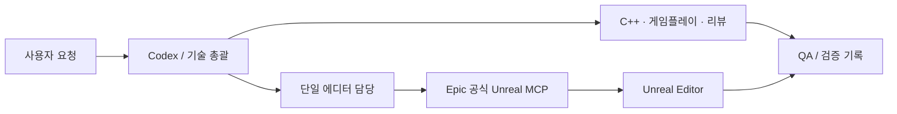

# Unreal Codex Studio

[](https://github.com/Junghyeon0710/unreal-codex-studio/actions/workflows/validate.yml)
[](LICENSE)

**Epic 공식 Unreal MCP를 사용하는 Codex용 Unreal 개발 워크스페이스.**

15개 스킬, 9개 전문 역할, 프로젝트 연결 검사, MCP 클라이언트, 빌드·테스트·패키징 명령 도구를 제공합니다.
게임마다 반복하는 작업 규칙을 재사용하고, 실제 엔진 검증 결과를 남기는 것이 목적입니다.
독립적인 커뮤니티 프로젝트이며 Epic Games나 OpenAI의 공식 제품은 아닙니다.

> 공식 MCP는 Unreal의 Experimental 기능입니다. **Windows / Unreal 5.8.4에서 실제 MCP 테스트**를 수행했습니다.
> 검증 범위와 Codex 실행 결과는 [검증 기록](docs/validation-results.md)을 확인하세요.
> Python CI는 Unreal Engine이나 게임을 실행하지 않습니다.

## 무엇이 들어 있나요?

- **역할 분담:** 기술 총괄, C++, Blueprint, 게임플레이, UI, 네트워크, 빌드, QA, 성능.
- **공식 에디터 연결:** ModelContextProtocol + AllToolsets. 별도 서드파티 Unreal 브리지 없이 연결합니다.
- **오작업 방지:** 연결된 에디터가 지정한 프로젝트인지 확인하고, 에디터 변경은 담당자 한 명이 순차 수행합니다.
- **재현 가능한 도구:** 프로젝트 스캔, doctor, 도구 스키마 탐색, 명령 계획/실행, 격리 프로젝트 실동작 테스트.
- **검증 구분:** 소스 검사, C++ 빌드, Blueprint 컴파일, PIE, 게임플레이, 패키지 실행을 각각 보고합니다.



에이전트 파일을 설치한다고 모든 역할이 자동 실행되지는 않습니다.
Codex의 역할 지원과 사용자의 작업 범위에 따라 필요한 역할만 사용합니다.
에디터 변경 작업은 동시에 실행하지 않습니다.

## 빠른 시작

필요 환경: Python 3.11+, Codex, 공식 MCP가 포함된 Unreal Engine.
실제 검증 엔진은 **UE 5.8.4**입니다. 5.7 백포트나 다른 버전은 이 저장소의 검증 대상이 아닙니다.

```sh
git clone https://github.com/Junghyeon0710/unreal-codex-studio.git
cd unreal-codex-studio
python tools/studio.py --help
```

1. 이 폴더를 Codex에서 열고 내용을 검토한 뒤 프로젝트를 신뢰합니다.
2. Unreal 프로젝트에서 **Unreal MCP**와 **All Toolsets**를 활성화하고 에디터를 재시작합니다.
3. 에디터 콘솔에서 `ModelContextProtocol.StartServer 8000`을 실행합니다.
4. 정확한 프로젝트와 엔진 경로로 확인하고 Codex 연결을 활성화합니다.

```powershell
python tools/studio.py doctor --engine "D:/Epic Games/UE_5.8" --project "D:/Games/MyGame/MyGame.uproject" --url http://127.0.0.1:8000/mcp
python tools/studio.py connect --url http://127.0.0.1:8000/mcp
```

Codex를 다시 열고 다음처럼 요청합니다.

```text
$ue-start
프로젝트는 D:/Games/MyGame/MyGame.uproject,
엔진은 D:/Epic Games/UE_5.8 이야.
공식 MCP 연결을 확인하고 현재 모듈 구조를 설명해줘.
```

경로는 `studio.local.example.json`을 `studio.local.json`으로 복사해서 관리할 수도 있습니다.
이 파일은 Git에서 제외됩니다. CLI는 실수를 줄이기 위해 경로 인자를 명시적으로 받습니다.
기존 게임에 이 저장소를 덮어쓸 필요 없이 별도 Codex 작업 폴더로 사용할 수 있습니다.

## 스킬

| 스킬 | 용도 |
|---|---|
| `$ue-start` | 프로젝트 시작·작업 분류 |
| `$ue-doctor` | 엔진·공식 플러그인·연결 대상 검사 |
| `$ue-project-scan` | 모듈·플러그인·타깃 조사 |
| `$ue-feature` | 기능 구현과 역할 배분 |
| `$ue-cpp` | C++·UHT·수명 관리 |
| `$ue-blueprint` | MCP 기반 Blueprint 편집·컴파일 |
| `$ue-ui` | UMG·CommonUI 작업 |
| `$ue-data` | DataTable·DataAsset·원본 데이터 |
| `$ue-review` | 변경 사항 검토 |
| `$ue-build` | UBT 빌드 |
| `$ue-test` | Unreal Automation 검증 |
| `$ue-pie-check` | PIE 실행·관찰·종료 |
| `$ue-package` | UAT 쿠킹·패키징 |
| `$ue-package-smoke` | 패키지 시작·동작 확인 |
| `$ue-diagnose` | 로그·실패 원인 분석 |

GAS, Niagara, PCG, World Partition 등은 프로젝트에서 필요할 때 실제 설치된 도구셋을 탐색합니다.
도구 개수나 기능 지원을 고정해서 가정하지 않습니다.

## 직접 테스트하기

아래 테스트는 **빈 테스트 프로젝트에 새 에셋을 생성합니다.**
기존 게임에는 실행하지 말고 별도 fixture를 사용하세요.

```powershell
python tools/studio.py example --destination "../StudioLab"
python tools/studio.py launch --engine "D:/Epic Games/UE_5.8" --project "../StudioLab/StudioLab.uproject" --port 8017
```

`launch`는 기본적으로 실행 명령을 출력합니다. 출력된 명령으로 에디터를 실행하거나 `--run`을 추가합니다.
에디터가 준비되면:

```powershell
python tools/live_smoke.py --project "../StudioLab/StudioLab.uproject" --url http://127.0.0.1:8017/mcp --output ".studio/live-smoke.json" --allow-fixture-write
```

검증: 프로젝트 연결 → Blueprint 생성·컴파일 → 지정 에셋 저장·디스크 확인 → 액터 배치·조회 → PIE 실행·종료.
에셋은 검사할 수 있도록 fixture에 남깁니다. 레벨은 저장하지 않습니다.

## 구조

```text
AGENTS.md                  공통 작업 원칙
.agents/skills/            15개 Unreal 스킬
.codex/agents/             9개 Codex 역할
.codex/hooks/              바이너리 패치 방지·역할 실행 기록
.codex/config.toml         역할 및 MCP 설정 (연결은 기본 비활성)
tools/                    Python 표준 라이브러리 기반 실행 도구
tests/                    독립 실행 가능한 도구 테스트
templates/                기능·검증 기록 양식
docs/                     설치, MCP, 호환성, 검증 기록
```

자세한 내용: [설치](docs/getting-started.md) · [공식 MCP](docs/official-mcp.md) ·
[검증 기준](docs/verification.md) · [기여](CONTRIBUTING.md) · [원본과 라이선스](UPSTREAM.md)

## License

MIT. [Claude Code Game Studios](https://github.com/donchitos/claude-code-game-studios)의
스튜디오 구조를 바탕으로 Unreal과 Codex에 맞게 새로 구성했습니다.
원본 저작권 고지를 보존합니다. Unreal Engine 및 Epic 플러그인 소스·바이너리는 배포하지 않습니다.
